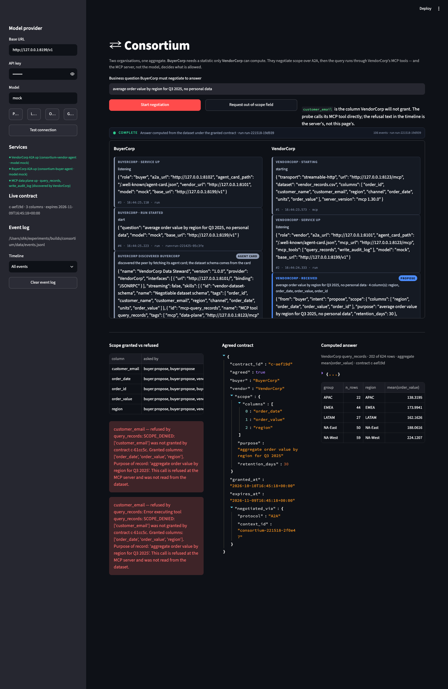
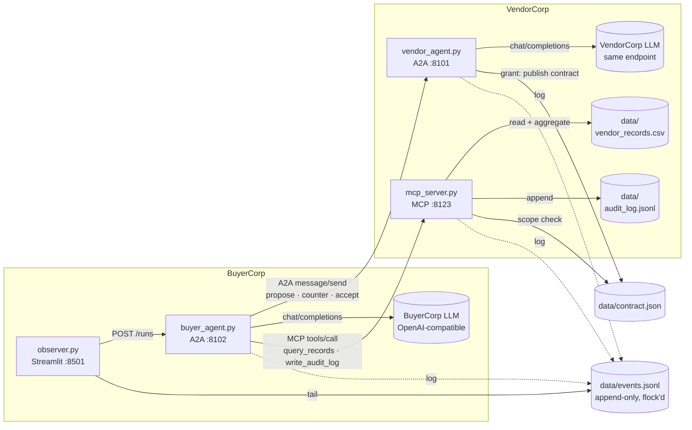
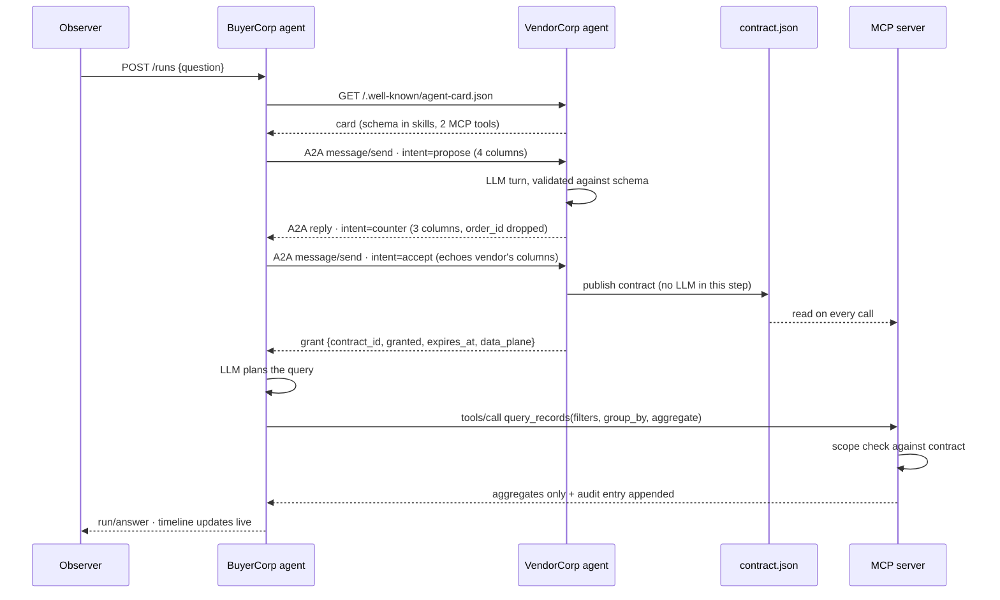

# consortium

**Two organisations. One aggregate. A real protocol between them.**

BuyerCorp's agent needs a statistic it cannot compute. VendorCorp's agent holds the dataset and
will not hand it over until they agree terms. They negotiate a data-sharing contract over **A2A**,
and when the deal is struck the actual work runs through **MCP tools** — where the MCP server, not
the language model, decides what is allowed.

Every A2A message and every tool call is visible, one at a time, in a live observer.



---

## Table of contents

- [What this demonstrates](#what-this-demonstrates)
- [Quickstart](#quickstart)
- [The negotiation protocol](#the-negotiation-protocol)
- [Architecture](#architecture)
- [Where enforcement actually lives](#where-enforcement-actually-lives)
- [Verification](#verification)
- [The data](#the-data)
- [Model provider quirks](#model-provider-quirks)
- [Testing without an API key](#testing-without-an-api-key)
- [Tech stack](#tech-stack)
- [Design decisions](#design-decisions)
- [Known limitations](#known-limitations)
- [Contributing](#contributing)
- [Ideas to build on top](#ideas-to-build-on-top)

---

## What this demonstrates

Three things, each of which is easy to fake and hard to do properly:

1. **Negotiation between independent parties.** Two agents, two processes, two organisations.
   Neither can read the other's data. They exchange scope proposals as structured JSON messages
   over a real wire protocol, and the exchange has a winner: VendorCorp counters narrower, BuyerCorp
   accepts, and a contract with an expiry is published.
2. **The protocol is the visible thing.** No framework-internal group chat, no hidden agent loop.
   One A2A `message/send` per negotiation turn, each with its own task and context id, appended to
   an event log the observer tails. If you want to know what was agreed and when, read the log.
3. **Refusals come from the data plane.** When BuyerCorp asks for `customer_email` — a column
   VendorCorp refused to grant — the rejection is raised by the MCP server that holds the CSV. The
   UI only displays the string it received. An agent cannot negotiate with the refusal, and a
   prompt injection cannot talk its way past it.

## Quickstart

Requires **Python 3.11+** (developed and verified on 3.12) and four free ports:
`8123` (MCP), `8101` (vendor), `8102` (buyer), `8501` (observer).

```bash
# 1. virtualenv + dependencies
uv venv --python 3.12 .venv
uv pip install -p .venv/bin/python -r requirements.txt
#   …or:  python -m venv .venv && .venv/bin/pip install -r requirements.txt

# 2. configuration: base URL, key, model
cp .env.example .env
#    then edit .env and set OPENAI_API_KEY

# 3. the dataset is committed, but regenerate it to prove it is deterministic
.venv/bin/python scripts/make_data.py

# 4. run the test suite (20 checks, no model calls)
.venv/bin/python -m unittest discover -s tests -t .

# 5. start everything: MCP server → vendor → buyer → observer
./run.sh start
open http://127.0.0.1:8501
```

`./run.sh status` prints each service's identity, `./run.sh stop` shuts them down, `./run.sh tail`
follows their logs. Prefer to start them yourself:

```bash
.venv/bin/python mcp_server.py &      # VendorCorp's data plane, streamable HTTP on :8123
.venv/bin/python vendor_agent.py &    # VendorCorp's A2A agent on :8101
.venv/bin/python buyer_agent.py &     # BuyerCorp's A2A agent on :8102
.venv/bin/streamlit run observer.py --server.port 8501 --server.headless true
```

Then type a business question in the observer and press **Start negotiation**:

> average order value by region for Q3 2025, no personal data

and press **Request out-of-scope field** to watch the MCP server refuse it.

## The negotiation protocol

Every A2A message in this demo is one JSON object, produced with `response_format:
{"type": "json_object"}` and validated before it is allowed to touch anything:

```json
{
  "from": "buyer|vendor",
  "intent": "propose|counter|accept|reject|request",
  "scope": {
    "columns": ["region", "order_value", "order_date"],
    "purpose": "average order value by region for Q3 2025",
    "retention_days": 30
  },
  "rationale": "one sentence"
}
```

`core/negotiation.py` is the gate. It rejects an unknown `from`, an unknown `intent`, any extra or
missing key at either level, a non-integer or non-positive `retention_days`, an empty `columns`
list (except on `reject`), and — importantly — any column name that is not in the dataset schema
the peer published in its agent card. A message that fails is not repaired: the sender is asked
once more with the failure explained, and if it fails again the run errors out.

```python
message = validate_message(raw, expect_from="buyer", known_columns=known)
```

`expect_from` is what stops one agent answering on the other's behalf — a reply that arrives with
`"from": "buyer"` when VendorCorp is speaking is a schema violation, not a detail.

## Architecture

### Processes

| Process | Port | Role |
|---|---|---|
| `mcp_server.py` | `8123` (streamable HTTP `/mcp`) | VendorCorp's data plane. Owns the CSV, the audit log, and the scope check. |
| `vendor_agent.py` | `8101` (A2A JSON-RPC) | VendorCorp's steward agent. Negotiates scope, publishes contracts. |
| `buyer_agent.py` | `8102` (A2A JSON-RPC + control API) | BuyerCorp's agent. Drives the negotiation, then calls the vendor's MCP tools. |
| `observer.py` | `8501` | Streamlit. Tails `data/events.jsonl`; writes nothing except config and run triggers. |

### Components



### One negotiation, start to finish



### File map

```
├── mcp_server.py        VendorCorp's MCP tools + the scope check that refuses out-of-contract calls
├── vendor_agent.py      A2A server, steward policy, deterministic contract grant
├── buyer_agent.py       A2A client + its own A2A server, negotiation driver, MCP execution
├── observer.py          Streamlit timeline, scope panel, contract panel, provider config
├── core/
│   ├── config.py        .env-backed provider + endpoint config, presets
│   ├── contract.py      the grant, and evaluate() — the policy decision the MCP server makes
│   ├── dataset.py       CSV loading, filtering, aggregation (VendorCorp-side only)
│   ├── events.py        append-only JSONL event log, cross-process via fcntl
│   ├── model.py         Agent Framework client wiring, JSON mode + retry, provider shims
│   └── negotiation.py   the message schema, its validator, and the shared prompt block
├── scripts/
│   ├── make_data.py     deterministic generator for data/vendor_records.csv
│   ├── verify.py        the three end-to-end demos, with assertions
│   ├── counts.py        checks the character limits claimed in docs/
│   └── mock_provider.py DEV ONLY scripted provider — exercises the stack without a key
├── tests/test_core.py   20 unit checks on schema, scope, aggregation, config, event log
├── docs/
│   ├── blog.md          long-form technical write-up
│   ├── x-thread.md      two-tweet thread   ·  linkedin-post.md — three sub-300-char variants
│   ├── assets/observer.png
│   └── verification/    captured event logs + audit entries from the demos
└── data/vendor_records.csv   624 committed rows, 8 columns
```

There is a long-form write-up of how this works, and what went wrong while building it, in
[`docs/blog.md`](docs/blog.md).

## Where enforcement actually lives

The negotiation is advisory. The enforcement is `contract.evaluate()`, called inside the MCP tool
before a single row is read:

```python
# mcp_server.py
dataset_columns = set(columns())
referenced = _referenced_columns(filters, group_by, aggregate)
allowed, reason, contract = evaluate(referenced, dataset_columns)
if not allowed:
    _record_call("query_records", arguments, decision="refusal", reason=reason, contract=contract)
    raise ToolError(reason)          # → MCP isError → ToolExecutionException at the caller
```

`ToolError` makes the refusal an *MCP-level* error, so the reason string travels the wire as data
the server produced. Four distinct refusals exist, and they are deliberately different:

| Code | Meaning |
|---|---|
| `NO_CONTRACT` | nothing has been granted yet — no negotiation, no access |
| `SCOPE_DENIED` | the contract exists but does not cover this column |
| `CONTRACT_EXPIRED` | the retention window has passed; renegotiate |
| `UNKNOWN_COLUMN` | that column does not exist in the dataset at all |

Two more rules are enforced in code rather than in a prompt, because a prompt is a request and code
is a guarantee:

- **Personal data is filtered out of every grant.** `PII_COLUMNS = {"customer_name",
  "customer_email"}` is applied to the vendor's own reply *after* the model produces it, so an
  over-granting model cannot widen the contract.
- **An `accept` cannot smuggle in scope.** VendorCorp honours an acceptance against *its own last
  offer*, not against what the buyer claims to accept:

```python
widening = sorted(buyer_cols - offered_cols)
if widening:
    return {"from": "vendor", "intent": "reject", "rationale":
        f"An accept may only confirm the scope VendorCorp offered; {widening} was never offered, "
        "so this reads as a new proposal rather than an acceptance."}
```

## Verification

Run `.venv/bin/python scripts/verify.py` to reproduce all three checks; it starts the stack itself,
drives the buyer over HTTP, and asserts against `data/events.jsonl` — the same file the observer
renders, so a check that passes here cannot be one the UI would hide.

> **Provider used for the captured runs below:** `scripts/mock_provider.py`, the scripted
> development provider, because no API key was configured when these were captured. The
> **numbers are model-independent** — the aggregates and every refusal string are produced by the
> MCP server from the committed CSV, and verify identically on any provider. What a real model
> changes is the *wording and column choices* of the negotiation messages, not the enforcement.
> `docs/verification/*.jsonl` holds the full captured logs.

### 1 · A real aggregate, computed from the CSV, plus a real audit entry

Negotiation as it landed in the log (`seq` from `data/events.jsonl`):

```text
 7 a2a      buyercorp   send         buyer:propose  ['region','order_date','order_value','order_id']
 8 a2a      vendorcorp  inbound      buyer:propose
10 a2a      vendorcorp  outbound     vendor:counter ['order_date','order_value','region']
12 a2a      buyercorp   peer-message vendor:counter
14 a2a      buyercorp   send         buyer:accept   ['order_date','order_value','region']
17 a2a      vendorcorp  outbound     GRANT c-020682
22 mcp      buyercorp   call         query_records
23 mcp      vendorcorp  result       query_records
27 run      buyercorp   answer
```

`order_id` was in the buyer's proposal and is *not* in the grant — VendorCorp narrowed it, and the
contract that was published records that:

```json
{
  "contract_id": "c-020682",
  "agreed": true,
  "buyer": "BuyerCorp",
  "vendor": "VendorCorp",
  "scope": {
    "columns": ["order_date", "order_value", "region"],
    "purpose": "aggregate order value by region for Q3 2025",
    "retention_days": 30
  },
  "granted_at": "2026-10-10T16:44:25+00:00",
  "expires_at": "2026-11-09T16:44:25+00:00",
  "negotiated_via": { "protocol": "A2A", "context_id": "consortium-221425-48ae71" }
}
```

The answer `query_records` returned — 202 of 624 rows matched the Q3 filter:

| region | n_rows | mean(order_value) |
|---|---:|---:|
| APAC | 22 | 138.3195 |
| EMEA | 44 | 173.9941 |
| LATAM | 27 | 162.1626 |
| NA-East | 50 | 188.0616 |
| NA-West | 59 | 224.1207 |

Those five means are cross-checked two independent ways: `scripts/make_data.py` prints the same
figures straight from the rows it generated, and `tests/test_core.py` recomputes them with
`statistics.fmean` and asserts equality to 4 decimal places.

And the audit entry the buyer wrote through `write_audit_log`, verbatim from
`data/audit_log.jsonl`:

```json
{"logged_at": "2026-10-10T16:44:25.506+00:00", "contract_id": "c-020682", "entry": {
  "actor": "BuyerCorp", "purpose": "aggregate order value by region for Q3 2025",
  "columns": ["order_date", "order_value", "region"],
  "query": {"filters": {"order_date": {"gte": "2025-07-01", "lte": "2025-09-30"}},
            "group_by": "region", "aggregate": {"function": "mean", "column": "order_value"}},
  "status": "allowed", "refusal_reason": null, "rows_matched": 202,
  "granted_columns": ["order_date", "order_value", "region"]}}
```

### 2 · A question that names `customer_email` is refused by the MCP tool

The negotiation goes the same way — the buyer asks for `customer_email`, the vendor counters it
away, the buyer accepts a three-column scope — and then the buyer's planner still needs that column
to answer the question it was given:

```text
46 mcp  buyercorp       call      query_records  group_by='customer_email'
47 mcp  vendorcorp-mcp  refusal   query_records
48 mcp  buyercorp       refusal   query_records
49 mcp  vendorcorp-mcp  refusal   write_audit_log     ← the accountability call is checked too
```

The refusal string, exactly as the MCP server produced it:

```text
SCOPE_DENIED: ['customer_email'] was not granted by contract c-61cc5c. Granted columns:
['order_date', 'order_value', 'region']. Purpose of record: 'aggregate order value by region for
Q3 2025'. This call is refused at the MCP server and was not read from the dataset.
```

No row was read, no value was leaked, and the same scope check then refused the buyer's attempt to
*record* the attempt, because the audit entry itself named the column.

### 3 · Kill the MCP server mid-run

The data plane is terminated while a run is in flight. The run does not hang and the observer does
not spin: the buyer's MCP connect fails, the failure is logged as an event, and the run ends in the
`error` state carrying the real message:

```json
{"plane": "mcp", "actor": "buyercorp", "kind": "connection-error",
 "tool": "query_records", "url": "http://127.0.0.1:8123/mcp",
 "error": "ToolException: MCP server failed to initialize: [Errno 61] Connection refused"}
```

`scripts/verify.py` asserts three things here: a transport-error event exists, the terminal event is
`error` rather than a stalled spinner, and the terminal event carries the failure text.

## The data

`data/vendor_records.csv` — 624 rows, 8 columns, committed so the demo is reproducible:

```csv
order_id,customer_name,customer_email,region,channel,order_date,units,order_value
ORD-100001,Anders Machado,anders.machado.000@example.com,NA-West,retail,2025-09-16,7,191.92
ORD-100002,Nils Adeyemi,nils.adeyemi.001@example.com,LATAM,online,2025-12-19,5,201.05
```

`sha256 05724fdfc153ff156a498a125f2ff60c184c2517ec3cc489ff5af957084b6944`

**Why a documented generator instead of a public dataset.** The spec allowed either, and for this
particular demo the choice matters: a public dataset with usable `customer_name` +
`customer_email` pairs is *real people's personal data*, and this project is about refusing to hand
that over. So the PII columns here are synthetic and provably not real — every address is at
`example.com`, the domain IANA reserves for documentation (RFC 2606), with a numeric suffix.

**Determinism.** `random.Random(20261010)`, no wall-clock input, no network. Re-running
`scripts/make_data.py` reproduces the committed file byte for byte and prints the sha256 plus the
ground-truth aggregates the verification section quotes.

## Model provider quirks

Both agents talk to one OpenAI-compatible `/chat/completions` endpoint through Agent Framework's
`OpenAIChatCompletionClient` with a configurable `base_url`. Three real-world quirks are handled in
`core/model.py`, and each one is surfaced as an event rather than silently absorbed:

1. **`api.particle.ai` returns `metadata` as an object** on replies that use tools or structured
   output, while the OpenAI SDK types that field as `str | None` — so every request dies in
   validation. An httpx `response` event hook rewrites the field to `null` before the SDK sees it.
   It must be a coroutine: httpx awaits response hooks, and a sync hook fails with
   *"object NoneType can't be used in 'await' expression"*.
2. **`deepseek-v4.1-flash` bills its entire completion budget on hidden reasoning** unless the
   request says otherwise, returning `content: ""` with `finish_reason: length`. `OPENAI_REASONING_EFFORT=none`
   is sent by default and is configurable.
3. **LM Studio rejects `response_format: {"type": "json_object"}`** with HTTP 400. The first such
   failure flips JSON mode off for the process, logs a `capability-fallback` event, and replies are
   parsed tolerantly instead — so the negotiation schema survives a provider that cannot enforce it.

## Testing without an API key

`scripts/mock_provider.py` is a scripted OpenAI-compatible endpoint that returns the *shape* a
well-behaved pair of agents produces: propose four columns, counter to three, accept verbatim, plan
the aggregate the question asks for. Point `.env` at it and the entire stack — A2A, contracts, MCP,
scope enforcement, refusals, transport failures — runs end to end.

```bash
.venv/bin/python scripts/mock_provider.py &
OPENAI_BASE_URL=http://127.0.0.1:8199/v1 OPENAI_API_KEY=mock OPENAI_MODEL=mock ./run.sh start
```

It is a harness, not a demo. Its replies are scripted from prompt section headers, so nothing it
produces is model output and no run against it is evidence — which is why `verify.py` prints the
provider it used and this README labels its captured runs accordingly.

## Tech stack

| | |
|---|---|
| **Agent framework** | Microsoft Agent Framework 1.x — `agent-framework-core` 1.21.0, `agent-framework-openai` 1.16.0, `agent-framework-a2a` 1.0.0b261002 |
| **Protocol** | A2A via `a2a-sdk` 1.2.2 (agent cards, JSON-RPC, task lifecycle) |
| **Tools** | MCP via `mcp` 1.30.0 — `FastMCP` server on streamable HTTP, `MCPStreamableHTTPTool` client |
| **Serving** | FastAPI 0.141.1 + uvicorn 0.54.0 |
| **UI** | Streamlit 1.65.0, fragments for 1.5 s auto-refresh |
| **Model transport** | `openai` 3.28.0 SDK over `httpx` 0.28.1 |
| **Storage** | CSV + append-only JSONL. No database. |

Only three Agent Framework packages are needed; `requirements.txt` lists them explicitly instead of
the `agent-framework` meta-package, which pulls ~30 provider integrations this demo never imports.

## Design decisions

- **The buyer calls the vendor's MCP tools directly.** Control plane (A2A) negotiates; data plane
  (MCP) executes; the vendor publishes the agreed scope to a file the MCP server re-reads per call.
  This is what makes the refusal interesting: it is issued by an independent enforcement point, not
  by the agent that just agreed the terms.
- **The grant is not model-authored.** When an `accept` arrives, VendorCorp publishes the contract
  in code, from its own last offer. A deterministic step for a deterministic decision.
- **The driver owns the loop, not the framework's orchestration.** One A2A message per turn, so the
  protocol is legible in the log. The framework still supplies the agent, the session, the MCP
  client and the A2A executor.
- **Non-streaming A2A turns.** `A2AExecutor(stream=False)` returns its reply as a task artifact, and
  the streamed path surfaced nothing but an empty final response on these versions. One
  request/response per negotiation message is also a more honest protocol trace.
- **The observer derives state from the log.** `idle / negotiating / executing / complete / error`
  are computed from the events after the last `run/start`, never stored as a flag — so a process that
  died mid-run cannot leave the UI claiming to be healthy.
- **Service identity is checked, not assumed.** The sidebar only marks a port "up" when the JSON on
  it carries `service: consortium-vendor-agent`. A 200 from something else's uvicorn is reported as
  exactly that.

## Known limitations

- **One host, one trust domain.** The contract is a file the vendor writes and the MCP server reads.
  On a single machine that models the boundary; across machines it needs signing and a real
  authorisation check on the MCP endpoint, which is deliberately out of scope here.
- **No authentication on any endpoint.** A2A and MCP both answer anyone on localhost.
- **`InMemoryTaskStore`.** A2A task state is lost when a process restarts; the contract and the
  audit log survive because they are files.
- **Refusal text is a string.** `SCOPE_DENIED` is matched by prefix in the panels; a structured
  error payload would be better.
- **No license chosen yet.** See [Contributing](#contributing).

## Contributing

Fork it, then:

```bash
git checkout -b your-name/short-branch
uv venv --python 3.12 .venv && uv pip install -p .venv/bin/python -r requirements.txt
cp .env.example .env
.venv/bin/python -m unittest discover -s tests -t .     # must stay green
.venv/bin/python scripts/verify.py                       # must print ALL CHECKS PASSED
```

House rules this codebase actually follows:

- **No invented data, no stub output.** Anything a check depends on must flow through the real code
  path. If you cannot run a path, say so rather than simulating it.
- **State substitutions.** If you swap the provider, the port, or the transport, document what
  actually ran and why — the README's "Provider used" note is the pattern.
- **Enforcement stays in code.** New policy (retention caps, forbidden columns, rate limits) belongs
  in `core/contract.py` or `mcp_server.py`, not in a sentence in a prompt.
- **Every protocol turn is an event.** If you add a step, log it with `core.events.emit()` so the
  observer shows it. A feature that is invisible in the timeline is not finished.
- Keep the four spec'd entry points (`mcp_server.py`, `vendor_agent.py`, `buyer_agent.py`,
  `observer.py`) importable as standalone scripts; shared code goes in `core/`.

Good first issues:

1. Add a `LICENSE` (MIT or Apache-2.0) — the repo has none.
2. Emit a structured refusal payload (`{"code": "SCOPE_DENIED", "column": …}`) alongside the
   human-readable string, and have `mcp_server.py` return it as MCP structured content.
3. Add a `--strict` flag to `verify.py` that fails if any event was produced by the mock provider.
4. Write the missing test for `vendor_agent.VendorService._apply_policy` (the PII filter and the
   retention cap are currently only covered end to end).

## Ideas to build on top

- **Signed contracts.** VendorCorp signs the grant (Ed25519); the MCP server refuses any call whose
  contract it cannot verify, and the buyer's copy becomes evidence rather than a cache.
- **Column-level masking instead of refusal.** Grant `customer_email` but only as a salted hash or a
  first-initial, so the buyer can group by *cohort* without ever seeing an address.
- **A third party.** An auditor agent that holds no data but is granted read access to the audit log
  and can replay any negotiation from the event log.
- **Row-level policy.** Extend the contract with a `where` clause ("only orders from 2025") that the
  MCP server injects into every query, so the buyer cannot widen the population either.
- **Push notifications over A2A.** Long-running aggregations return `input-required`, and the vendor
  completes the task asynchronously — the SDK supports it and the observer already renders task state.
- **Contract expiry you can watch.** A "burn down the retention window" demo mode that rewrites
  `expires_at` into the past and shows `CONTRACT_EXPIRED` mid-session.
- **A denial that is also a negotiation.** When the MCP server refuses, feed the refusal back into
  the A2A loop as a `request` turn so the agents renegotiate automatically — with the human watching
  the second negotiation happen.