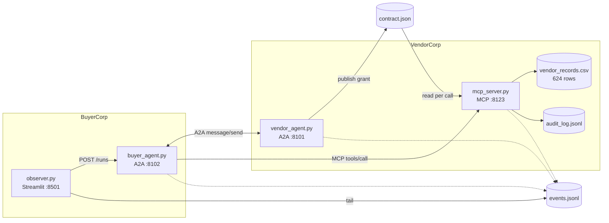

# Two agents, two companies, one protocol: building a visible agent-to-agent negotiation

*How `consortium` works: Microsoft Agent Framework 1.x, A2A for the negotiation, MCP for the work,
and a data plane that says no.*

---

There is a particular kind of agent demo I find unsatisfying. Five agents sit in a group chat, a
framework orchestrates their turn-taking, and the "negotiation" is a string of tokens inside one
process's memory. You can print it, but you cannot point at a protocol. Nothing crossed a wire.

So I built the version I wanted to look at: **two agents that belong to two different companies,
talking over a real protocol, where the thing that actually enforces the agreement is not a language
model.**

BuyerCorp's agent wants one number: average order value by region for Q3. It does not have the data.
VendorCorp's agent has the data and will not release anything until they agree which columns, for
what purpose, for how long. They negotiate that contract over **A2A**. When the deal is struck, the
query runs through **MCP tools** — and the MCP server refuses calls that step outside the contract,
in code, before reading a single row.

Everything is visible in a Streamlit observer, one message at a time.

It is ~2,300 lines of Python across four processes. This is how it is built, and the eight things
that cost me real time.

---

## The shape of it



| Process | Port | What it owns |
|---|---|---|
| `mcp_server.py` | 8123 | the CSV, the audit log, the scope check |
| `vendor_agent.py` | 8101 | VendorCorp's agent, the contract grant |
| `buyer_agent.py` | 8102 | BuyerCorp's agent, the negotiation driver |
| `observer.py` | 8501 | rendering. Writes nothing but config |

Two design choices do most of the work:

**The control plane and the data plane are different protocols.** A2A carries the argument. MCP
carries the data. The bridge between them is a file: when VendorCorp accepts, it publishes the
agreed scope to `data/contract.json`, which the MCP server re-reads on every call.

**The buyer talks to the vendor's MCP server directly.** That is what makes the refusal interesting.
If the vendor's own agent refused its own tool call, the enforcement would be a courtesy. Instead an
independent process — one the buyer cannot negotiate with — evaluates the request against the
contract and says no.

---

## Step 1: the negotiation is a schema, not a vibe

Every message is one JSON object:

```json
{
  "from": "buyer|vendor",
  "intent": "propose|counter|accept|reject|request",
  "scope": {
    "columns": ["region", "order_value", "order_date"],
    "purpose": "average order value by region for Q3 2025",
    "retention_days": 30
  },
  "rationale": "one sentence"
}
```

The rule I set myself: reject anything that does not parse, retry **once**, then fail the run. No
"best effort" path, because a best-effort negotiation is how you get a contract nobody agreed to.

The validator is deliberately picky:

```python
# core/negotiation.py
TOP_LEVEL = {"from", "intent", "scope", "rationale"}
SCOPE_KEYS = {"columns", "purpose", "retention_days"}

extra = sorted(set(obj) - TOP_LEVEL)
if extra:
    raise SchemaError(f"unexpected top-level key(s) {extra}; allowed: {sorted(TOP_LEVEL)}")

if expect_from and side != expect_from:
    raise SchemaError(f'expected "from": "{expect_from}", got "{side}" '
                      f"(a reply may not speak for the other party)")

if known_columns is not None:
    unknown = sorted(set(columns) - known_columns)
    if unknown:
        raise SchemaError(f"column(s) {unknown} are not in the dataset schema {sorted(known_columns)}")
```

Three details worth calling out:

- **`expect_from`** stops an agent answering on the other side's behalf. If VendorCorp's reply comes
  back with `"from": "buyer"`, that is a protocol violation, not a cosmetic slip.
- **Unknown columns are rejected against the peer's published schema.** Where does the buyer learn
  the column names? From the vendor's agent card. A model that invents `avg_order_value` never
  reaches the data plane.
- **Extra keys are rejected.** Tempting to add `"urgency": "high"`, and exactly the kind of drift a
  schema exists to stop.

The retry lives in the model call, not in the UI:

```python
# core/model.py — one round trip that must yield a parseable JSON object
try:
    parsed = extract_json(raw)
except ValueError as exc:
    if attempts > 1:
        emit("model", side, "parse-failed", turn=turn, attempts=attempts, error=str(exc), raw=raw[:800])
        raise ProtocolError(f"{side} reply was not valid JSON after one retry: {exc}")
    text = prompt + "\n\nYour previous reply could not be parsed as a single JSON object" \
                   f" ({exc}). Reply again with ONLY the JSON object: no prose, no code fence."
    continue
```

---

## Step 2: serving an agent as an A2A endpoint

Microsoft Agent Framework ships the bridge in `agent-framework-a2a`: `A2AExecutor` adapts an agent to
the SDK's `AgentExecutor`, and `a2a-sdk` supplies the routes.

```python
# vendor_agent.py
from a2a.server.request_handlers import DefaultRequestHandler
from a2a.server.routes import add_a2a_routes_to_fastapi, create_agent_card_routes, create_jsonrpc_routes
from a2a.server.tasks import InMemoryTaskStore
from agent_framework.a2a import A2AExecutor

card = AgentCard(
    name="VendorCorp Data Steward",
    version="1.0.0",
    provider={"url": url, "organization": "VendorCorp"},
    default_input_modes=["text"],
    default_output_modes=["text"],
    capabilities=AgentCapabilities(streaming=False),
    supported_interfaces=[AgentInterface(url=url, protocol_binding="JSONRPC")],
    skills=[...],
)

handler = DefaultRequestHandler(
    agent_executor=A2AExecutor(service, stream=False),
    task_store=InMemoryTaskStore(),
    agent_card=card,
)
app = FastAPI()
add_a2a_routes_to_fastapi(
    app,
    agent_card_routes=create_agent_card_routes(card),
    jsonrpc_routes=create_jsonrpc_routes(handler, rpc_url="/"),
)
```

`A2AExecutor` only needs something that satisfies `SupportsAgentRun` — `run()` plus
`create_session()`. That is the seam I used to put the protocol logic in one place: a `VendorService`
class that validates the inbound message, decides whether the turn needs the model at all, and logs
both sides of the wire.

The agent card is also how the vendor publishes its negotiable schema and its data plane:

```python
AgentSkill(
    id="vendor-dataset-schema",
    name="Negotiable dataset schema",
    description="Column names VendorCorp will negotiate access to. Names only: no rows and no "
                "values are exposed before a contract is granted.",
    tags=columns(),          # ← the schema the buyer validates proposals against
)
```

At startup the vendor connects to its *own* MCP server, calls `tools/list`, and embeds the real
input schemas in every grant it issues. So the buyer learns the tool signatures from the same place
it learns the columns.

---

## Step 3: calling a peer, and the `context_id` question

A negotiation has memory. VendorCorp must remember what it offered, or an acceptance means nothing.
The natural key is the A2A `context_id` — but does a client-supplied `context_id` survive across
separate `message/send` requests?

I tested it before building on it, and it does:

```python
session = AgentSession(service_session_id=A2AServiceSessionId(context_id=conversation))
final = await peer.run(body, session=session)
```

The vendor's `A2AExecutor` calls `create_session(session_id=task.context_id)`, and `task.context_id`
came back as exactly the string the buyer sent (`conv-A`, `conv-A`, `conv-B` in the probe). That is
the whole basis for the vendor's per-conversation state:

```python
self._offers: dict[str, dict[str, Any]] = {}      # context_id → last scope VendorCorp offered
self._transcripts: dict[str, list[dict[str, Any]]] = {}
```

Fetching the card is one line with a caveat:

```python
from a2a.client.card_resolver import parse_agent_card
card = parse_agent_card(response.json())
```

`parse_agent_card` exists because the served card carries legacy fields (`preferredTransport`,
`url`, `protocolVersion`) that the protobuf `AgentCard` does not have. `json_format.ParseDict`
without `ignore_unknown_fields=True` throws on them. Use the SDK's helper.

---

## Step 4: the data plane is an MCP server, not a function

`mcp_server.py` is a standalone process on streamable HTTP, so that "kill the MCP server mid-run" is
a thing you can actually do to it.

```python
from mcp.server.fastmcp import FastMCP, ToolError

mcp = FastMCP("vendorcorp-data", host="127.0.0.1", port=8123,
              streamable_http_path="/mcp", stateless_http=True, json_response=True)

@mcp.tool(name="query_records", description="Aggregate VendorCorp's order dataset. …")
async def query_records(filters: dict[str, Any], group_by: str | None,
                        aggregate: dict[str, Any]) -> dict[str, Any]:
    dataset_columns = set(columns())
    referenced = _referenced_columns(filters, group_by, aggregate)
    allowed, reason, contract = evaluate(referenced, dataset_columns)
    if not allowed:
        _record_call("query_records", arguments, decision="refusal", reason=reason, contract=contract)
        raise ToolError(reason)          # ← the refusal originates HERE
    result = run_query(filters, group_by or None, aggregate)
    ...
```

On the caller side, `ToolError` becomes `isError` on the wire, which Agent Framework's MCP client
raises as `ToolExecutionException` with the server's text intact:

```python
try:
    out = await tool.call_tool("query_records", **args)
except ToolExecutionException as exc:
    reason = str(exc)                   # the vendor's words, not ours
    emit("mcp", "buyercorp", "refusal", tool="query_records", arguments=args, reason=reason)
```

That distinction is the demo. A `ToolExecutionException` is a *policy* decision from the data owner.
Anything else — `ConnectionError`, `MCP server failed to initialize` — is a *transport* failure, and
the observer renders them differently.

---

## Step 5: where enforcement lives

`core/contract.py` holds the one function that decides anything real:

```python
def evaluate(referenced, dataset_columns, *, now=None) -> tuple[bool, str, dict | None]:
    unknown = sorted(referenced - dataset_columns)
    if unknown:
        return False, f"UNKNOWN_COLUMN: {unknown} is not a column of the VendorCorp dataset…", contract
    if contract is None:
        return False, "NO_CONTRACT: no negotiated contract has been published…", contract
    if _expired(contract, now):
        return False, f"CONTRACT_EXPIRED: {contract['contract_id']} expired at {contract['expires_at']}…", contract
    denied = sorted(referenced - granted)
    if denied:
        return False, (f"SCOPE_DENIED: {denied} was not granted by contract {contract['contract_id']}. "
                       f"Granted columns: {sorted(granted)}. Purpose of record: "
                       f"{contract['scope']['purpose']!r}. This call is refused at the MCP server "
                       f"and was not read from the dataset."), contract
    return True, "", contract
```

Four refusal codes, deliberately distinct, because "the column does not exist" and "you were not
granted the column" are different incidents.

And two rules that are **code, not prompt** — because a prompt is a request and code is a guarantee:

```python
PII_COLUMNS = {"customer_name", "customer_email"}

def _apply_policy(self, message):
    kept = [c for c in message["scope"]["columns"] if c not in PII_COLUMNS]
    removed = sorted(set(message["scope"]["columns"]) - set(kept))
    if removed:
        emit("contract", "vendorcorp", "policy-filter", removed=removed,
             reason="PII_COLUMNS is enforced in vendor_agent.py after the model replies")
        message["intent"] = "counter"
    message["scope"]["retention_days"] = min(retention, MAX_RETENTION_DAYS)   # 90-day cap
```

If the model over-grants, the grant is narrower than the model's reply, and the log says so.

The second rule closes the hole I thought about hardest. What stops a buyer sending an `accept`
whose scope quietly includes `customer_email`? Nothing in the message format. So VendorCorp honours
an acceptance against **its own last offer**, never against what the buyer claims to accept:

```python
buyer_cols, offered_cols = set(accepted["scope"]["columns"]), set(offered["columns"])
widening = sorted(buyer_cols - offered_cols)
if widening:
    return {"from": "vendor", "intent": "reject", "rationale":
        f"An accept may only confirm the scope VendorCorp offered; {widening} was never offered, "
        "so this reads as a new proposal rather than an acceptance."}
```

The grant step also skips the model entirely. Once both sides agree, publishing a contract is a
deterministic act; routing it through an LLM adds a chance of hallucinating terms into a document
that is about to become an access-control policy.

---

## Step 6: the observer is a log reader

Four processes append to one JSONL file. Cross-process ordering is the only hard part: take an
exclusive `fcntl` lock, read the tail to find the last `seq`, append, `fsync`.

```python
with _lock, open(LOG_PATH, "a+", encoding="utf-8") as handle:
    fcntl.flock(handle.fileno(), fcntl.LOCK_EX)
    event["seq"] = _next_seq(handle)          # parse the last line of the tail
    handle.write(json.dumps(event) + "\n")
    handle.flush(); os.fsync(handle.fileno())
```

The UI rule I cared about: **never render a message that did not happen.** No seeded timeline, no
placeholder exchange. An empty log draws an empty state that tells you what to start.

State is derived, not stored:

```python
def derive_state(events):
    if not events: return "idle", "No event has been written yet…"
    starts = [i for i, e in enumerate(events) if e["plane"] == "run" and e.get("kind") == "start"]
    if not starts: return "idle", "…no negotiation has been requested."
    tail = events[starts[-1]:]
    if any(e.get("kind") in ("error", "transport-error", "connection-error") for e in tail):
        return "error", …
    if any(e["plane"] == "mcp" and e.get("kind") in ("call", "connect", "result", "refusal") for e in tail):
        return "executing", "Calling the VendorCorp MCP data plane"
    return "negotiating", "A2A messages are exchanging between the two agents"
```

A stored flag would lie the moment a process dies mid-run. Derived state cannot.

Same instinct for the health dots in the sidebar: a 200 from a port proves nothing about *which*
process answered, so each check requires an identity field:

```python
if isinstance(body, dict) and body.get("service") == "consortium-vendor-agent":
    …report up…
elif body and body.get("service"):
    …report "port answered by X — not this build"…
```

The MCP row goes further: it is reported up only when the *vendor* successfully discovered tools from
it at startup, which is evidence the data plane answered a real `tools/list`.

---

## Eight things that cost time

1. **A CSV reader that silently produced garbage.** `[{field: _coerce(raw) for field, raw in
   zip(fields, record)}]` where `record` is a `DictReader` row — zipping a list against a **dict**
   iterates its *keys*, so every cell became its own column name and every mean was `null`. No
   exception anywhere. Found by printing one result. Correct form:
   `{field: _coerce(record[field]) for field in fields}`.
2. **httpx awaits response hooks.** The shim for the provider quirk below was written as a plain
   function, which produced `TypeError: object NoneType can't be used in 'await' expression` wrapped
   in a framework exception that did not mention hooks. It must be `async def` with `await
   response.aread()`.
3. **`api.particle.ai` returns `metadata` as an object** on structured replies while the OpenAI SDK
   types it `str | None`, so valid responses fail client-side validation. Fixed with the hook from
   (2): null the field, rewrite the body, never touch a non-JSON (SSE) response.
4. **`deepseek-v4.1-flash` spends the whole completion budget on hidden reasoning** and returns
   `content: ""`. `reasoning_effort: "none"` in the request body fixes it; without it, every agent
   turn looks like an empty model.
5. **Streaming A2A returned nothing.** `A2AExecutor(stream=False)` puts its reply in a task artifact;
   asking `A2AAgent.run(stream=True)` for it yielded zero updates and an empty final response on
   these versions. Non-streaming works, and one request/response per negotiation message is a more
   honest trace anyway. Card advertises `streaming=False` to match.
6. **API surface drift in Agent Framework 1.x.** `MCPClient` is gone — it is `MCPStdioTool` /
   `MCPStreamableHTTPTool` now, `tool.functions` is a **list** not a dict, `call_tool()` returns
   `list[Content]` rather than a string, and `ToolExecutionException` lives in
   `agent_framework.exceptions`, not the package root. `A2AContinuationToken` is not re-exported
   through the `agent_framework.a2a` lazy shim either.
7. **`st.fragment` in Streamlit 1.65 returns a plain function** — no `.run()`, so dynamic
   `run_every` is not available the way the docs' examples imply. Fixed the interval instead. Also
   `use_container_width` is deprecated in favour of `width='stretch'`.
8. **My own `run.sh` lied.** It reported "observer up" because the port was open — held by a stale
   instance it did not own, while its own process had exited with "Port 8501 is not available". Now
   it refuses to start a service whose port is held by someone else *and* checks the child it spawned
   is still alive.

---

## What it actually produces

Negotiation, from the captured event log:

```text
 7 a2a      buyercorp   send         buyer:propose  ['region','order_date','order_value','order_id']
 8 a2a      vendorcorp  inbound      buyer:propose
10 a2a      vendorcorp  outbound     vendor:counter ['order_date','order_value','region']
14 a2a      buyercorp   send         buyer:accept   ['order_date','order_value','region']
17 a2a      vendorcorp  outbound     GRANT c-020682
22 mcp      buyercorp   call         query_records
23 mcp      vendorcorp  result       query_records
27 run      buyercorp   answer
```

The vendor dropped `order_id`; the buyer accepted the narrower scope; the contract carries a 30-day
expiry and the A2A `context_id` it was negotiated under. The answer is 202 of 624 rows:

| region | n_rows | mean(order_value) |
|---|---:|---:|
| APAC | 22 | 138.3195 |
| EMEA | 44 | 173.9941 |
| LATAM | 27 | 162.1626 |
| NA-East | 50 | 188.0616 |
| NA-West | 59 | 224.1207 |

Same question, but naming the email column, and the data plane answers:

```text
SCOPE_DENIED: ['customer_email'] was not granted by contract c-61cc5c. Granted columns:
['order_date', 'order_value', 'region']. Purpose of record: 'aggregate order value by region for
Q3 2025'. This call is refused at the MCP server and was not read from the dataset.
```

Kill the MCP server mid-run and the run ends instead of hanging:

```json
{"plane": "mcp", "actor": "buyercorp", "kind": "connection-error",
 "error": "ToolException: MCP server failed to initialize: [Errno 61] Connection refused"}
```

**One honest caveat.** Those runs were driven through `scripts/mock_provider.py`, a scripted
OpenAI-compatible endpoint, because no provider key was configured when I captured them. The
aggregates and every refusal string are model-independent — the MCP server computes them from the
committed CSV, and `tests/test_core.py` recomputes the means with `statistics.fmean` and asserts
equality. What a real model changes is the *wording and column choices* inside the negotiation
messages. The harness is a plumbing test, and I have labelled it as one rather than letting it pass
for a demo.

---

## Try it, or read the interesting files

```bash
git clone https://github.com/harishkotra/consortium
cd consortium && uv venv --python 3.12 .venv
uv pip install -p .venv/bin/python -r requirements.txt
cp .env.example .env          # put a key in, or point at scripts/mock_provider.py
./run.sh start                # http://127.0.0.1:8501
```

If you want to read three files rather than eight:

- **`core/contract.py`** — the entire policy model in ~120 lines.
- **`mcp_server.py`** — where a refusal is born.
- **`vendor_agent.py`** — the part where an agent decides *not* to call its model.

---

*Built by [Harish Kotra](https://harishkotra.me) · [Checkout my other builds](https://dailybuild.xyz)*
